  

  

  
  
  

---

## `01` — About

I build web experiences and automation tools, with a focus on practical solutions that are simple to use and maintain. Most of my work revolves around **JavaScript/TypeScript**, **WhatsApp bot development**, and **Linux-based deployment**.

- Developing WhatsApp bots and multi-device automation
- Building and deploying web projects
- Connecting APIs, databases, and backend services
- Managing Node.js applications on Linux VPS with PM2

## `02` — Animated Developer Dashboard

  

## `03` — GitHub Overview

  

Statistics are generated from the GitHub API by GitHub Actions and refreshed daily.

  <a href="https://github.com/zaxxinfinity">GitHub</a> ·
  <a href="https://zynnshima.web.id">Portfolio</a>

