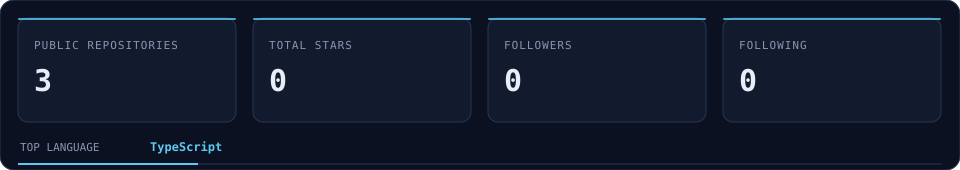

  

  

  
  
  

---

## `01` — About

I build web experiences and automation tools, with a focus on practical solutions that are simple to use and maintain. Most of my work revolves around **JavaScript/TypeScript**, **WhatsApp bot development**, and **Linux-based deployment**.

- Developing WhatsApp bots and multi-device automation
- Building and deploying web projects with Vercel
- Connecting APIs, databases, and backend services
- Managing Node.js applications on Linux VPS with PM2

## `02` — Tech Stack

<table>
  <tr>
    <td width="50%" valign="top">
      <strong>Programming Languages</strong>  
       
      JavaScript · TypeScript  
      <strong>Markup & Styling</strong>  
       
      HTML5 · CSS3
    </td>
    <td width="50%" valign="top">
      <strong>Runtime, Backend & Automation</strong>  
       
      Node.js · PostgreSQL · Baileys · PM2 · REST APIs
    </td>
  </tr>
  <tr>
    <td width="50%" valign="top">
      <strong>Tools & Deployment</strong>  
      
    </td>
    <td width="50%" valign="top">
      <strong>Areas of Interest</strong>  
      Bot engineering · API integration · Web development · Linux server operations
    </td>
  </tr>
</table>

## `03` — Selected Work

<table>
  <tr>
    <td width="50%" valign="top">
      <a href="https://github.com/zaxxinfinity/tourl"><strong>tourl ↗</strong></a> 
      File upload utility that converts files into shareable links.
    </td>
    <td width="50%" valign="top">
      <a href="https://zynnshimaa.vercel.app/"><strong>Portfolio ↗</strong></a> 
      Personal website showcasing development and design work.
    </td>
  </tr>
</table>

## `04` — GitHub Overview

  

  Statistics are generated from the GitHub API by GitHub Actions. Updated daily.

## `05` — Contact

  
  

Designed with SVG, CSS animation, and a little pixel-art inspiration.

